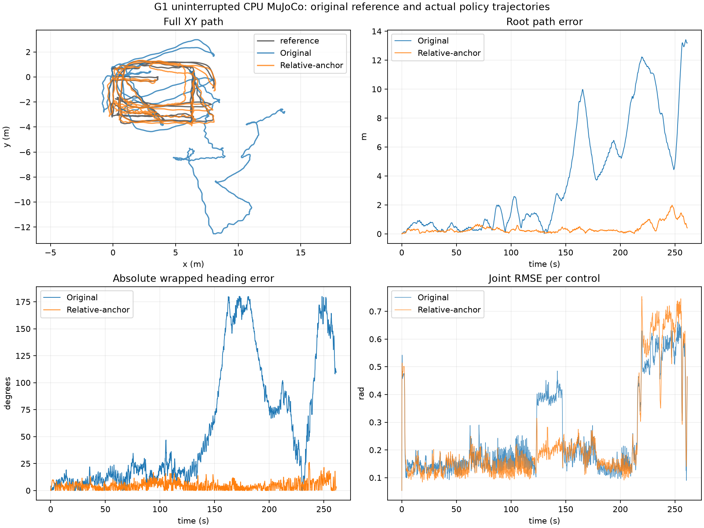

# G1 当前动作能力与后续优化

当前可以确认的是 **MuJoCo 中的参考动作行走跟踪**。输入是一条预先准备的 G1 参考动作，输出为 29 个关节的控制目标。它尚不是自主导航、键盘速度控制或任意动作切换器，也没有实机验证。

## 实测动作范围

以下跨动作探测使用前 7 小时交付的 `exports/g1-best/`，检查点 `3842a75c…`。该模型只训练过 `walk1_subject1`；其他片段均未参与训练。每条参考从首帧初始化，随后实际求解物理，不自动重置或写入参考状态。这里的完整执行仅表示未触发高度／倾斜终止。

| 动作 | 实际执行 / 参考时长 | 结果 | 能力判断 |
| --- | --- | --- | --- |
| 行走 `walk1_subject1` | 261.30 / 261.30 秒 | 完整执行；路径 RMSE 5.408 m | 已验证连续行走，原版路径误差明显 |
| 跳跃 `jumps1_subject1` | 244.42 / 244.42 秒 | 完整执行；未观察到至少 40 ms 的双脚离地 | 不视为已实现跳跃 |
| 舞蹈 `dance1_subject1` | 106.72 / 131.46 秒 | 倾斜误差触发终止 | 未通过整段验证 |
| 格斗 `fight1_subject2` | 24.96 / 244.86 秒 | 高度误差触发终止 | 未通过整段验证 |

跳跃片段实际根高度约 0.704–0.813 m，参考约 0.556–0.912 m；实际最大根竖直速度约 0.480 m/s，参考约 2.471 m/s。结合真实足部求解力，没有证据支持将这种“完整执行”称为跳跃模仿成功。40 ms 离地统计只是一项诊断，跳跃成功还需要起落时序、姿态、接触和高度等验收。

原始跨动作结果见本机 [探测记录](../runs/capability-probes-20261106/summary.json)，每条片段目录保存实际物理轨迹和逐子步接触力。以上不是论文动作集 benchmark，也不代表其他模型、动作或初始条件的成功率。

## 行走纠偏实验

原版策略没有相对参考路径的位置／朝向反馈。原版前 60 秒路径 RMSE 约 0.518 m，前 120 秒约 0.917 m，而整段达到 5.408 m；整段朝向 RMSE 约 81.28°。这说明长时漂移比仅观察前十秒更严重。

本轮启用已有的相对躯干位姿接口，将目标从 680 维扩展到 689 维，再从原最佳模型微调。原始权重和 Adam 状态保留，新增输入的权重从零开始；迁移时实际验证 actor 的动作误差小于 4e-7。这是使用仿真位姿反馈的可选扩展，默认 SuperMimic 基线与原交付包保留。

候选选择规则为：完整连续执行 13065 个控制、整段回报不低于原版 0.6503826 的候选中，选择根平面 RMSE 最小者；朝向、关节 RMSE 用于打破相同值。另外保留最高回报候选。训练使用相同单条行走动作，单次微调预算为 15 分钟，不能据此声称留出动作泛化能力。

<!-- FINAL_ANCHOR_RESULTS -->
最终交付为 seed 42 的 **42519** 迭代检查点（从原 36000 迭代继续训练 6519 迭代）。评测了 14 个微调候选；只有完成整段的候选参加交付选择。本次最小路径误差与最高回报恰好来自同一检查点。

| 模型 | 整段回报 | 平面 RMSE（m） | 最大平面误差（m） | 朝向 RMSE（°） | 关节 RMSE（rad） | 连续执行（秒） |
| --- | --- | --- | --- | --- | --- | --- |
| 原默认接口 | 0.6504 | 5.408 | 13.415 | 81.28 | 0.2933 | 261.30 |
| 相对躯干位姿反馈扩展 | 0.8215 | 0.495 | 1.982 | 5.94 | 0.2963 | 261.30 |

平面 RMSE 降低约 **90.8%**，朝向误差明显改善，关节误差略有增加。最大位置误差仍约 **1.98 m**，不能称为厘米级循迹。平均平面速度 0.504 m/s（参考 0.504 m/s），实际路径长度 131.42 m。实际物理子步中没有检测到非足部地面受力。所有结果仅对应这条动作、首帧初始化和当前固定仿真环境；不代表随机初始状态成功率。



最终部署包另外独立执行了一次完整物理重放，回报、位置／朝向／关节误差与所选评测一致；没有自动重置或修改物理状态。软件回放使用 llvmpipe，无 CUDA 分配。

### 最终扩展模型的跨动作探测

以下均未使用相应动作微调，只是同一个最终行走模型的单次探测：

| 参考动作 | 执行 / 参考时长（秒） | 平面 RMSE（m） | 关节 RMSE（rad） | 结论 |
| --- | --- | --- | --- | --- |
| 跳跃参考 | 244.42 / 244.42 | 0.991 | 0.349 | 观察到 1 次 80 ms 双脚卸载，尚不能认定跳跃模仿成功 |
| 舞蹈参考 | 106.72 / 131.46 | 1.044 | 0.382 | 倾斜误差终止，未通过整段验证 |
| 格斗参考 | 25.04 / 244.86 | 1.728 | 0.483 | 高度误差终止，未通过整段验证 |
| 固定姿态参考（合成） | 30.00 / 30.00 | 0.012 | 0.500 | 平衡维持 30 秒；全身定姿未通过验收 |

静态参考由训练动作首帧保持 30 秒并将参考速度置零生成。实际最大平面偏差 0.030 m、平均移动速度 0.0058 m/s，但关节 RMSE 为 0.500 rad，未达到探测前设定的 0.2 rad 定姿门槛。可以报告短时原地平衡现象，不能据此认定精确全身定姿或行走／站立切换已验证。

跳跃参考中实际根高度仅约 0.692–0.808 m、最大上升速度约 0.658 m/s，仍明显偏离参考；一次离地不能说明掌握了反复跳跃和起落时序。完整跨动作记录见 [最终模型探测](../runs/anchor-capability-probes-20261106/summary.json)。原版的接触诊断另存 [接触审计](../runs/capability-probes-20261106/contact-audit.json)。

### 验证与交付

完整 CPU／CUDA 回归 **79 项通过，无跳过**，包括新增接口的 CPU／GPU 特征对照、迁移前后动作与 critic 数值、Adam 状态迁移及新增输入实际梯度、朝向环绕与接触卸载统计。Ruff、离线锁文件检查和 wheel／源码包构建通过。微调显存采样峰值 **1562 MiB（1.53 GiB）**，训练进程树 RSS 峰值 **4.00 GiB**；全部回归 RSS 峰值 **4.86 GiB**。记录见 `runs/anchor-full-regression-20261106/worker.log` 和 `run.json`。

- [部署契约](../exports/g1-anchor/contract.json)：整个目录 `exports/g1-anchor/` 即最终扩展包，原版 `exports/g1-best/` 未替换。
- [选择规则与完整评测](../runs/anchor-final-20261106/selection.json)；[独立物理部署](../runs/anchor-final-20261106/mujoco/result.json)。
- [新回放视频](../runs/anchor-final-20261106/mujoco/preview.mp4)；[完整物理状态与接触力](../runs/anchor-final-20261106/mujoco/trajectory.npz)。
- 可续训检查点：`runs/anchor-final-20261106/training-checkpoint.pt`。训练源码保存在 `implementation/`，实际部署源码另存 `deployment-implementation/`。

检查点 SHA-256：`bc95a21eb9b55ba56aafd6b5bd4dc9ba663f19f7f087d674348318243ec633c4`。

```bash
./supermimic deploy --bundle exports/g1-anchor \
  --motion data/npz/g1/walk1_subject1.npz --output runs/my-anchor-deploy
```

<!-- END_FINAL_ANCHOR_RESULTS -->

## 运行方式

迁移只接受可信本地完整训练检查点，输出路径必须不存在：

```bash
./supermimic enable-anchor \
  --checkpoint runs/final/training-checkpoint.pt \
  --output runs/my-anchor-start/checkpoint.pt

./supermimic train --profile paper-width --num-envs 128 \
  --policy-batch-size 48 --wm-batch-size 512 --replay-capacity 1000 \
  --wm-batches-per-update 10 --compile-policy --compile-world-model \
  --checkpoint runs/my-anchor-start/checkpoint.pt \
  --seed 42 --hours 0.25 --output runs/my-anchor-training
```

迁移后的模型必须继续训练才能利用新增反馈，单纯扩展输入不会自动纠偏。实际实验的配置、输入摘要、源码快照和资源记录位于 `runs/anchor-finetune-20261106-a/`；评测位于 `runs/anchor-evaluations-20261106/`。所有大文件均为本机产物，不随 Git 分发。

训练继续采用单工作进程、2304 MiB 显存／6 GiB RSS 上限，并保留 4096 MiB 全局空闲显存、8 GiB 可用内存、20 GiB 磁盘；CPU 部署另受 3 GiB 上限保护。接口细节见 [实现约定](REPRODUCTION.md)。
