# 实现约定与验证边界

本仓库实现固定 Cuboi SuperMimic 算法族的动作跟踪：以真实物理采样拟合可微世界模型，再通过想象轨迹更新策略和 critic。G1 使用固定 mjlab 资产；训练与部署共享控制约定。这里列出代码实际采用的约定，不把上游未明确的选择称为官方接口。

```mermaid
flowchart LR
    CSV[G1 CSV · 30 Hz] --> FK[CPU 重采样与 FK]
    FK --> NPZ[50 Hz NPZ + 名称与摘要]
    NPZ --> SIM[G1 · MuJoCo Warp]
    SIM --> REPLAY[按环境分组的回放]
    REPLAY --> WM[8 步世界模型拟合]
    WM --> IMAG[可微想象 · H=32]
    IMAG --> POLICY[目标编码器 + 策略 + critic]
    POLICY --> SIM
    POLICY --> EXPORT[CPU actor + 控制契约 + MJB]
    EXPORT --> DEPLOY[CPU MuJoCo · 连续物理部署]
    DEPLOY --> METRICS[轨迹 / 接触力 / 覆盖率 / 误差]
```

## 数据与状态

| 对象 | 约定 |
| --- | --- |
| CSV | 根位置 3、根四元数 `xyzw` 4、29 个关节角；输入帧率由参数显式给出 |
| NPZ | 50 Hz；29 关节与 30 刚体都有名称；刚体四元数 `wxyz`；刚体线／角速度在世界系 |
| 模拟器状态 | 71 维：位置 3、根四元数 4、关节角 29、根世界线速度 3、根本体角速度 3、关节速度 29 |
| 世界模型上下文 | 足部摩擦 1、编码器偏置 29、躯干质心偏移 3，共 33 维 |
| 仿真时钟 | 200 Hz 物理、4 次子步一个控制，控制频率 50 Hz |

CSV 转换前检查时间和数组大小，单片段限制 250,000 个输出帧。NPZ 读取前限制解压大小，检查数据形状、有限性、名称和四元数。每条片段分别解析刚体顺序。训练使用独立只读输入副本，准备清单存在时还核对清单摘要；运行结束再次校验副本。

## 策略接口

单帧观测依次为相对默认关节角 29、关节速度 29、本体角速度 3、投影重力 3、上一条干净动作 29，共 93 维。10 帧历史从旧到新，按观测项分别展平，得到 930 维；重置时重复第一帧。动作尺度和观测固定分量尺度均保留。

目标为 10 个参考帧，每帧 68 维：相对默认关节角、关节速度、参考投影重力、参考本体角速度、参考朝向系线速度和高度，共 680 维。默认没有额外锚点观测。已有 `anchor_obs` checkpoint 使用独立的 689 维契约，不能与默认输入混载。

可选 `enable-anchor` 在目标末尾增加 9 维：参考躯干相对实际躯干的位置 3 维，以及相对旋转矩阵前两列按行展平的 6 维。这一扩展直接提供偏离参考位置／朝向的反馈；它改变默认策略的观测接口，需要仿真位姿信息，不代表已具备实机状态估计。真实环境、想象轨迹和 CPU 部署保持相同的坐标变换与布局，另有 GPU／CPU 对照测试。

迁移将 actor 第一层新增列置零，critic 在原目标与上下文之间插入零列，同时保留原权重、Adam 一／二阶矩和训练计数。迁移时用非零输入验证 actor／critic 数值；新增列可通过后续训练获得非零权重。浮点矩阵计算形状改变仍可能带来微小数值差异，因此不保证长时间物理轨迹逐点一致。原检查点保持不变，迁移摘要随新检查点与导出契约保存。这是可选的跟踪接口实验，不与默认 SuperMimic 基线混报。

固定 mjlab 版本在 reset 后推进一次 command：物理状态从参考第 0 帧初始化，第一次策略输入从目标第 1 帧开始。CPU 部署保持这个顺序，并按环境的 0.9 软关节限位初始化关节位置。GPU 对照测试逐步检查实际历史观测与目标，避免一帧错位。

归一化动作按 `q_target = q_default + action_scale * action` 转为关节目标。执行器的物理顺序与策略关节顺序不同，导出时通过名称和编译模型建立映射。PD 参数、力矩限制和动作尺度由训练同源场景派生，并与新 checkpoint 中记录的控制契约核对。

## 学习与恢复

世界模型学习带上下文的状态增量与终止概率，观测和奖励由解析函数生成。策略通过冻结的世界模型做 BPTT，critic 使用固定的想象轨迹目标拟合。默认 G1 配置减少网络宽度和批量，`paper-width` 保留网络宽度；它们都不是论文规模的运行。

可选 `--policy-update-scope decoder`／`action-head` 限制演员优化器可更新的参数，后者仅更新原最后Linear层。默认all与原完整更新逐值等价，网络结构与BPTT目标不变；冻结层仍保留对想象状态输入的导数，不用detach切断反馈。完整Adam参数组及冻结层原动量／步数保留，因此未以删除优化器状态伪装为续训。该限制为本项目的微调实验，不宣称已有论文基准或技能通过结果。

本仓库对固定上游增加了数值稳定处理：想象存活概率低于 `policy_trainer.min_survival=1e-6` 的分支成为吸收分支，不再外推反馈；critic 仅拟合可到达状态，并按其存活概率加权 MSE。这样可避免终止后动作指数放大、`0 * inf` 和无到达概率的巨大目标污染拟合。终端 bootstrap 同样屏蔽这些状态。损失和梯度在优化器更新前检查有限性，异常时保留先前正常检查点并报告失败。上述改动已明确记录，不宣称与未修改上游逐步等价；实际 MuJoCo 部署不使用这些想象重置或分支处理。

回放行存储当前状态及其后继 transition。终止标签属于该行执行动作后到达的状态，采样窗口从 transition 行读取标签。终止状态额外存一行，用作窗口末端，不产生跨回合 transition。

恢复保留网络、优化器、采样器、累计更新计数及随机状态；未保存 replay 和实际仿真状态，因此重新收集回放后再更新，不保证与不中断训练逐步等价。动作数据指纹改变时拒绝沿用旧采样器状态。域随机化按固定实现执行：摩擦与编码器偏置在回合重置时更新，躯干质心偏移在启动时采样。

运动学按树深度批量计算独立肢体，同时保留串行参考。测试覆盖 MuJoCo 的位置／姿态／速度对照，以及批量实现与参考的输出和梯度一致性。可选 `--compile-policy` 编译想象步骤，仍受同一资源监督；默认不编译。

## 评测含义

部署不自动重置，保存初始状态和每次真实控制后的状态。默认执行 `frames - 1` 个控制，覆盖整个参考时间区间；高度误差超过 0.25 m 或倾斜误差超过 0.8 就停止。CPU MuJoCo 与 GPU Warp 的精度和求解路径不同，CPU reached-state 解析回报也不同于 GPU 环境中存在一个物理子步延迟的 reward manager，不宣称逐步物理或回报完全相同。

结果分别记录：

- 是否执行完整动作、失败时间和原因；
- 执行部分归一化回报、整条动作以零补齐的回报、覆盖率；
- 根平面位置误差、环绕处理后的根朝向 RMSE、关节角误差、高度与倾斜误差；
- 每个 200 Hz 子步实际求解得到的足部／非足部地面接触力。

动作完成只表示没有触发上述终止，不替代位姿或路径精度。非足部地面受力统计不代表所有自碰撞情况。真实物理轨迹回放视频使用 CPU Mesa 软件渲染，图像只读取已保存的物理状态，不重新驱动仿真，也不改写轨迹。

部署还统计两个足部的求解力范数均小于 1 N、且没有显著非足部地面受力的时间段，包括最长持续时间及至少 40 ms 的区间数。这用于揭示“跳跃参考片段完整执行，但实际仍在走路”等情况；仅离地也不等于跳跃动作模仿成功。旧轨迹可读取其逐物理步接触记录，用相同函数重算。

本轮按用户选择仅完成 MuJoCo 仿真部署；速度接口、其他目标编码器、官方模型兼容和实机控制不在当前交付范围。

## 模块与资源所有权

`config.py` 保存配置 dataclass，`interfaces.py` 保存 G1 关节顺序、跟踪刚体、观测项与目标项的维数。这两个模块只依赖标准库；无 checkpoint 的 profile 解析、内存估算和 `data.discovery` 文件选择也不加载 Torch 或仿真 SDK。旧实现模块仍重导出原配置类与常量，检查点继续存储相同的 `asdict` 字段树。环境观测项也按共享规范生成顺序，项名集合不匹配时在创建环境前拒绝。

共享动作库实现属于 `data.motion_library`，环境的 `envs.mdp.motion_library` 保留兼容导出。世界模型与想象轨迹通过 `world_model.reference` 共享参考帧，想象过程不再为了读取参考帧而导入拟合训练器。世界模型拟合仍只查询其损失需要的根位姿，紧凑动作库不会因此增加身体 FK 查询。

`checkpoints.read_checkpoint` 始终先在 CPU 读取。训练恢复显式使用 Linux `/proc/self/fd` 上的 mmap，映射绑定同一个已打开 inode，并要求输入在使用期间不被原地改写；原子轮转 `ckpt_latest` 不会改变已打开的输入。导出、迁移和权重 transfer 的来源摘要也绑定该 inode。评测使用兼容旧序列化格式的 CPU 读取，再仅将 actor 移至目标设备。

`checkpoints.write_checkpoint` 先写临时文件，再原子发布，失败清理部分写入。训练显式允许替换自己的 checkpoint，接口迁移保持独占发布，不覆盖已有输出。输入快照由 `artifacts.snapshot_file` 分块复制、复核摘要、只读发布；动作文件在复制前预检，复制后再次验证，使记录的帧数与实际副本一致。源码冻结及隔离 CLI 启动统一由 `runtime` 构造。CPU 部署保留历史三个文件的摘要，另以 `implementation_package_sha256` 记录整个包的 Python 源码清单，覆盖拆出的参考、接口与校验模块；该清单表示包源码身份，并非精确的运行时导入集合。

`Trainer` 创建环境、事件写入器与分布式状态后立即登记清理，即使初始化中途失败也释放已创建资源。`run()` 还原信号处理器并调用幂等 `close()`；worker 从持有 Trainer 开始负责最终关闭，因此运行状态文件写入失败也不会遗留环境。清理异常不会阻止其余资源清理。

部署契约在反序列化 actor 前检查观测项、历史布局、目标维数、坐标系及 50 Hz 控制时钟；加载 MJB 后再核对实际物理周期、状态维数和关节／执行器地址。早期 schema-v1 缺省的初始帧与首目标帧沿用 0／1，额外来源字段仍允许保留。数值上的 Torch 与 NumPy 观测、目标和旋转实现保持独立，便于继续做对齐验证。

`deployment.reference` 保存 NumPy／SciPy 的动作参考与旋转工具；轨迹对比绘图可直接导入它，无需导入策略运行器或 Torch。完整 `tracking_metrics` 仍通过 Torch、FK 和解析奖励评分，这部分依赖保持不变。`deployment.core` 继续重导出原参考工具，已有调用方无需迁移。

评测模块仅在实际创建评测环境时导入仿真接口；单独恢复 actor 不需要环境配置。想象目标函数对 rollout 类型的引用仅用于静态分析，不会为了计算损失而导入想象运行时。
