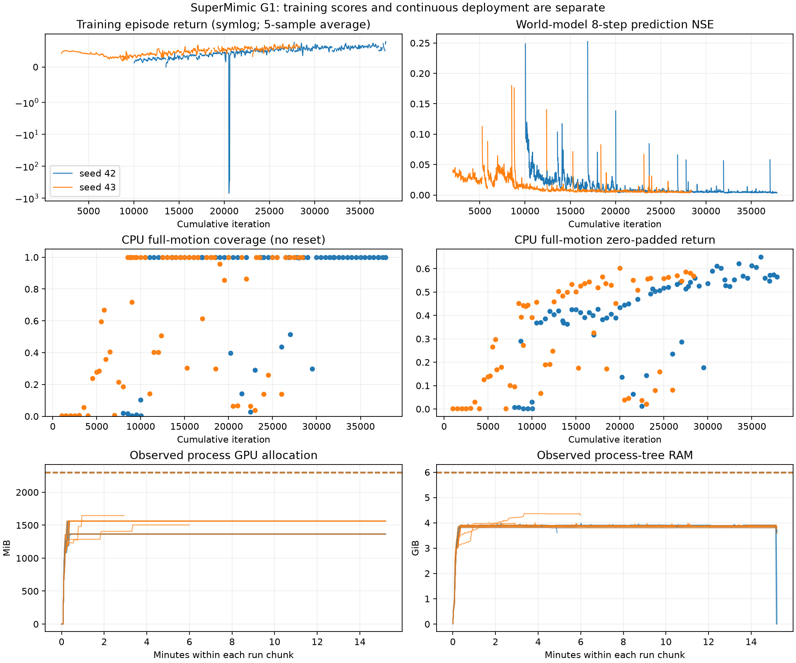
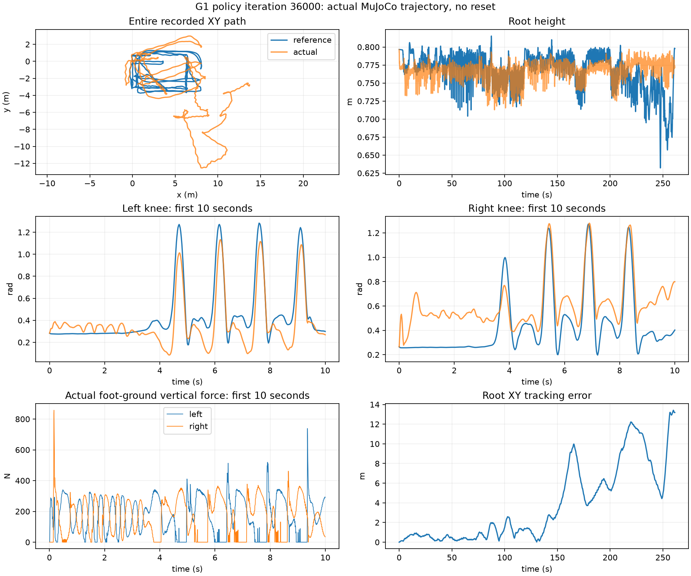

# 本轮复现与 MuJoCo 部署结果

工作窗口：2026-11-06 00:18:28–07:18:28（Asia/Shanghai），共 7 小时。以下模型选择记录于 `2026-11-05T23:14:50.307373+00:00`。本仓库维护独立 SuperMimic / Unitree G1 29 自由度链路，不依赖 EmbodiedForge 的 Python 包或运行目录。

此页保留前 7 小时默认接口的历史结果。后续动作探测和相对位姿反馈扩展实验见 [当前能力与优化记录](CAPABILITIES.md)。

## 实际结果

本轮两组独立种子均从零初始化，经真实 MuJoCo Warp 采样、世界模型拟合和 BPTT 策略更新得到。评测从参考首帧初始化，随后全程仅由策略控制；不自动重置，也不在后续帧强制写入参考姿态。完整执行为 **13065 个 50 Hz 控制、52260 个 200 Hz 物理子步，共 261.3 秒**。

| 模型 | 种子 / 累计迭代 | 整段归一化回报 | 关节 RMSE（rad） | 平面 RMSE（m） | 最大平面误差（m） | 控制步 |
| --- | --- | --- | --- | --- | --- | --- |
| 最高回报交付版 | 42 / 36000 | 0.6504 | 0.2933 | 5.408 | 13.415 | 13065 |
| 较低漂移对照版 | 42 / 31500 | 0.6028 | 0.3110 | 3.751 | 8.634 | 13065 |
| 独立种子 42 最佳整段 | 42 / 36000 | 0.6504 | 0.2933 | 5.408 | 13.415 | 13065 |
| 独立种子 43 最佳整段 | 43 / 20000 | 0.6029 | 0.3159 | 5.056 | 11.699 | 13065 |

最高回报版按完成整段后的归一化回报选择。较低漂移版选择规则为：**在完成整段、回报距离最高值不超过 0.05 的模型中，选择平面 RMSE 最小者**。该规则用于交付取舍，不是论文 benchmark 的选择规则；机器可读规则另存于各自 selection.json。这些选择均限于本轮独立训练模型；现有 EmbodiedForge 模型不参与选择。所有表内模型都执行完整参考区间，动作覆盖率为 1。

完整执行只表示没有触发根高度误差 0.25 m／倾斜误差 0.8 的终止条件，不代表高精度模仿。回报和关节误差的改善不保证平面轨迹误差改善。策略输入未包含全局平面位置与绝对航向，当前结果不足以支持高精度路径跟踪；请同时查看轨迹图和误差，不仅查看回报。





## 数据、来源和验证边界

- 训练与主要评测仅使用 `walk1_subject1.npz`，50 Hz、13066 帧。SHA-256：`4598698aa035c52ba160986e05796cb525df557d1879266e933c40a65994c041`。这是训练动作上的评测，没有完成全量或留出动作的论文 benchmark。
- 算法底座为固定 MIT 实现 `CuboiLeo/SuperMimic-Reproduced@d9be385b3eeb13a638fb33fb200d3bfd9be9839f`，来源与原始文件摘要见 [来源清单](../third_party/UPSTREAM.json)。没有使用官方模型权重。
- mjlab 固定提交 `8bb2bc9e187797689ec82c78c35019afd2fd0376`；Torch 2.14.1+cu130、MuJoCo / MuJoCo Warp 3.16.0、Warp 1.18.0。依赖以 `uv.lock` 为准，资产和许可证随导出包保存。
- 作为部署链路对照，已有本地 58000 步模型曾完成相同参考区间，回报 0.6383、关节 RMSE 0.1494 rad、平面 RMSE 7.825 m。它不属于本轮从零训练成果，也不作为官方结果。
- CPU reached-state 解析回报和 GPU 奖励管理器的时钟／浮点精度存在差异；不宣称两种后端逐步数值一致。
- 本轮交付为 MuJoCo 仿真部署。未执行实机通信、控制接管或硬件验证。非足部地面接触力统计不等同于自碰撞验收。

## 配置与资源

最终主要训练配置保持完整网络宽度：世界模型 2048×3，策略编码器／解码器 2048/1024/512/256；128 个环境、策略批量 48、世界模型批量 512×10、回放容量 1000、想象长度 32、拟合窗口 8。它仍是缩小规模配置。原始训练配置和恢复来源保留在每个运行目录。

采样到的最高工作进程显存为 **1646 MiB（1.61 GiB）**，训练和回归的最高进程树 RSS 为 **4.64 GiB**。默认训练上限为显存 2304 MiB／RSS 6 GiB；保留 4096 MiB 全局空闲显存、8 GiB 可用内存和 20 GiB 磁盘。共享显存／内存余量触发过保存和退避，没有调整其他任务。采样间隔为 2 秒，所列为采样峰值；Torch 另有分配器上限。

CPU 导出／部署单任务上限为 3 GiB，其他 CPU 工作流也有资源保护。软件回放在创建上下文前选择 Mesa 软件 EGL 设备，实际验证为 llvmpipe，不分配 CUDA 显存。

数值与工程修复包括：回放终止标签对齐、恢复后的回放补充、输入和源码快照、有限损失／梯度检查、终止想象分支的吸收处理、到达概率加权 critic，以及 G1 FK 批量化。改动与固定上游不保证逐步等价，具体约定见 [实现说明](REPRODUCTION.md)。

## 回归与本机产物

完整 CPU / CUDA 回归 **75 项通过**，含编译损失／参数梯度对照、G1 FK／解析奖励、非对称动作的关节映射、首帧时钟与历史、真实训练／恢复、数据和资源监督、策略导出与实际物理部署。记录见 `runs/full-regression-20261106/worker.log` 与 `run.json`。后续仅修改绘图／交付辅助，不改变经过回归的算法逻辑。

- [最高回报部署契约](../exports/g1-best/contract.json)，完整包位于 `exports/g1-best/`。
- [较低漂移部署契约](../exports/g1-lower-drift/contract.json)，完整包位于 `exports/g1-lower-drift/`。
- [交付选择与模型摘要](../runs/final/selection.json)，可续训检查点为 `runs/final/training-checkpoint.pt`。
- [最高回报模型物理回放](../runs/final/mujoco/preview.mp4) 与 [物理轨迹](../runs/final/mujoco/trajectory.npz)。
- `runs/seven-hour-20261106-evaluations/` 保存各检查点的导出包、连续部署、指标和已保留权重；`resources.jsonl`／`*.resources.json` 记录资源检查。

这些大文件为当前工作站生成的本地产物，由 `.gitignore` 排除。克隆代码后需准备有权使用的数据并训练，或自行放入可信检查点。

```bash
./supermimic deploy --bundle exports/g1-best \
  --motion data/npz/g1/walk1_subject1.npz --output runs/my-g1-deploy

./supermimic train --profile paper-width --num-envs 128 \
  --policy-batch-size 48 --wm-batch-size 512 --replay-capacity 1000 \
  --wm-batches-per-update 10 --compile-policy --compile-world-model \
  --checkpoint runs/final/training-checkpoint.pt \
  --hours 0.25 --output runs/my-g1-resume
```

最高回报检查点 SHA-256：`3842a75c651b25acabfbd19afe2280ab76a68889adf8ac8aa37fcf282420a617`。较低漂移检查点 SHA-256：`a9a696bda5fc9633ad7ed774e3f4c04e103dff93ad847ddc2db6e35737507371`。契约、策略与模型文件均经过摘要核对；重新打包后的最高回报版另执行一次完整 CPU MuJoCo 部署验证。
