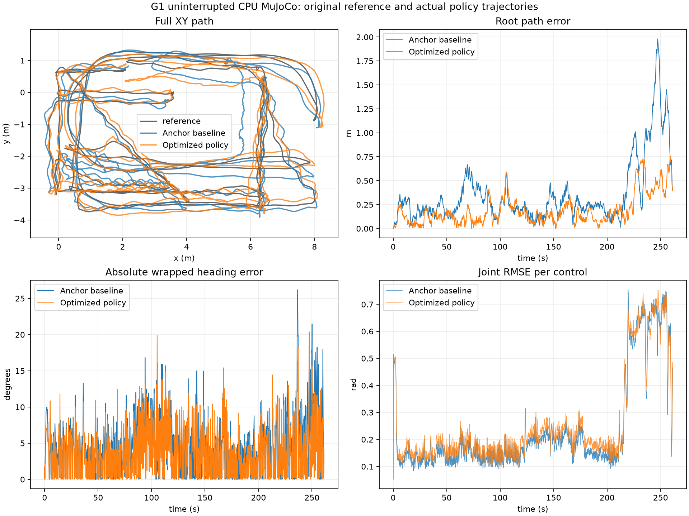

# G1 行走跟踪优化

README 的行走演示使用紧凑策略在 CPU MuJoCo 执行 `walk1_subject1` 的轨迹。完整参考包含 13,065 个控制步，共 261.30 秒。原锚点反馈策略的平面 RMSE 为 0.49539 m，紧凑策略为 0.19607 m。[演示与再生成命令](README.md)

## 紧凑策略

用全宽策略标注实际仿真中访问的状态，训练 4,255,805 参数的紧凑策略。初版补训使用原参考的闭环状态，进一步补训使用 0.97 和 1.03 倍速的闭环状态，共 104,543 条训练记录。最终对两版紧凑策略做参数插值，后者权重为 75%。说明和模型指纹见 [评测记录](walk-optimization.json)。

| 指标 | 全宽策略 | 紧凑策略 |
| --- | ---: | ---: |
| 完成控制步数 | 13,065 | 13,065 |
| 平面 RMSE（m） | 0.21111 | 0.19607 |
| 最大平面误差（m） | 0.69518 | 0.60329 |
| 关节 RMSE（rad） | 0.29110 | 0.29106 |
| 整段归一化回报 | 0.82828 | 0.83000 |
| 非足部地面受力子步 | 0 | 0 |
| 单线程部署中位用时（秒） | 18.65 | 7.98 |
| 策略文件大小（MiB） | 34.00 | 16.25 |



两种策略在同一逻辑核心上交替复跑三对。每种策略的三次轨迹及评分分别一致。紧凑策略重新导出后再次完成 261.30 秒，轨迹逐字节一致。当前 README 使用该轨迹第 245–250 秒的 GIF。

六个首帧复位片段和七组坐标变换均按预设门槛通过。其中 +137° 的变换用于训练，−79° 用于验证动作预测，另两组全新坐标 +51°、−154° 的平面 RMSE 分别由 0.23450 m 和 0.25240 m 降到 0.19712 m 和 0.21341 m。

| 节奏倍率 | 控制步 | 全宽平面 RMSE（m） | 紧凑平面 RMSE（m） |
| --- | ---: | ---: | ---: |
| 0.970 | 13,469 | 0.31505 | 0.24949 |
| 0.985 | 13,263 | 0.23594 | 0.24329 |
| 0.990 | 13,196 | 0.23862 | 0.24327 |
| 1.010 | 12,935 | 0.25455 | 0.24332 |
| 1.015 | 12,871 | 0.21832 | 0.23665 |
| 1.030 | 12,684 | 0.24113 | 0.24069 |

六组都完成了完整参考，平均平面 RMSE 下降 3.1%，其中 0.985、0.990 和 1.015 倍速的平面误差增加。另测同时调整节奏、偏航和平移的两组组合，两种策略均跑完全段，紧凑策略的平面 RMSE 分别为 0.24320 m、0.25112 m，对照为 0.24571 m、0.23653 m。这些变体均由同一训练参考生成。

补充组合复验用固定种子抽取 12 个 15 秒源片段，逐段改变起点、节奏、偏航和平移。两种策略各完成 12 组，非足部地面受力子步均为零。紧凑策略的平面 RMSE 中位数从 0.18552 m 降到 0.15456 m，其中四组平面 RMSE 上升。误差增加最多的一组由 0.12751 m 升到 0.20865 m。测试参数和结果见 [评测记录](walk-optimization.json)。

### 独立动作检查

从固定版本的 G1 重定向数据选择三条独立采集的参考，按原始 30 Hz 转为 50 Hz，使用相同 CPU MuJoCo 部署入口。三条参考均未参与本节两种策略的训练。各产物摘要见 [评测记录](walk-optimization.json)。[数据源](https://huggingface.co/datasets/lvhaidong/LAFAN1_Retargeting_Dataset/tree/07ff8845a94d59d4195a8ac04fe918d4e6338239/g1)

| 独立参考 | 要求控制步 | 全宽完成步 | 紧凑完成步 |
| --- | ---: | ---: | ---: |
| `walk1_subject2` | 13,065 | 13,065 | 13,065 |
| `walk2_subject3` | 11,908 | 8,664 | 2,431 |
| `walk3_subject4` | 12,330 | 4,899 | 4,915 |

完整执行的 `walk1_subject2` 上，全宽和紧凑的平面 RMSE 分别为 1.12819 m、1.21076 m。其余两条参考均触发姿态或高度终止，`walk2_subject3` 的紧凑策略还明显缩短了完成区间。README 的行走成绩来自 `walk1_subject1`。

### 镜像参考检查

以源动作首帧的 Y 坐标为反射面，交换左右关节，按关节轴变换角度和速度，并重新计算 G1 连杆状态。对镜像前后的 13,066 帧逐一核对，连杆位置相对于镜像预期的最大偏差为 0.000011 m。两条参考的关节样本均在模型限位内。

全宽策略完成镜像参考全部 13,065 步，平面 RMSE 为 0.77273 m。紧凑策略在第 5,299 步触发倾斜终止。镜像复验使用同一源动作的左右交换版本。

在已知参考经过镜像的条件下，对紧凑策略的观测历史、未来参考和动作执行相同的左右变换。无需再训练即可完成镜像参考 13,065 步，平面 RMSE 为 0.22401 m。0.97 和 1.03 倍速、两组坐标变换，以及独立 `walk1_subject2` 的镜像版也都完成各自完整参考。对应运行使用显式镜像推理包。

对原始和镜像动作同时训练的候选中，一组监督训练参数插值跑完了两条参考，平面 RMSE 分别为 0.22484 m 和 0.72374 m。将两种推理方向的动作等权平均也能跑完两条参考，两条的平面 RMSE 都超过 0.71 m。原始 README 演示使用普通紧凑策略的完整轨迹。[评测记录](walk-optimization.json)

### 补充训练试验

用原参考和 `walk1_subject5` 共同微调后，独立 `walk1_subject2` 完成全段，平面 RMSE 为 1.09318 m。`walk3_subject4` 完成 9,742／12,330 步。两条较难参考的完整执行仍有缺口。将归一化动作限制为 ±8 后，四参考训练完成 2,682 次更新。其原参考平面 RMSE 最低为 0.36756 m。

`walk2_subject3` 的一个重复终止点在 173.3 秒附近，参考髋部降到约 0.53 m 时，机器人髋部仍约 0.79 m。使用另一位受试者的低姿态片段训练后，从独立参考第 164 秒重新初始化的 20 秒复验仍在约 9.3 秒触发高度终止。

继续压缩到 3,041,789 个参数的版本，完整行走一次用时 6.51 秒，平面 RMSE 为 0.22073 m。上肢目标补训的版本将手臂 RMSE 从 0.36772 rad 降到 0.31095 rad，关节 RMSE 为 0.25720 rad，平面 RMSE 为 0.33600 m。额外版本均以实际完整仿真轨迹计分。

### 紧凑策略的后续对照

冻结解码器、对齐编码器的中间表示后，参数从 4,255,805 降到 3,683,645。完整参考的平面 RMSE 为 0.19469 m，三对单核复跑的中位用时从 7.88 秒降到 7.21 秒。该版本完成全部七组坐标变换，但其中五组超出平面 RMSE 或峰值限值。

将解码器续训参数与当前策略等权插值，完整参考的关节 RMSE 降到 0.27901 rad，平面 RMSE 为 0.21453 m。两组坐标变换和 238–258 秒首帧复位片段超出限值。在独立参考 `walk3_subject4` 上，该版本完成 9,742／12,330 步，对照完成 4,915 步。双方共有的前 4,915 步，平面 RMSE 从 0.62078 m 降到 0.60685 m。

另测四个 20 秒片段，保持参考不动，仅在机器人初始根位置加入最多 0.10 m 的单轴偏移并改变 7° 或 12° 偏航。三种策略各完成四组，非足部地面受力子步均为零。三个版本的平面 RMSE 中位数分别为 0.16728 m、0.16391 m（解码器插值）和 0.16931 m（较窄编码器）。README 保留通过原定坐标与复位门槛的紧凑策略。[评测记录](walk-optimization.json)

## 首次优化

从第 42,519 次迭代的锚点反馈模型开始，使用同一 `walk1_subject1` 参考进行小幅续训。根据平面跟踪误差调整损失权重、更新范围和复位采样。所有检查点按 CPU MuJoCo 的实际轨迹评分，完整参考包含 13,065 个控制步，共 261.30 秒。

| 指标 | 锚点反馈基线 | 优化策略（等权参数插值） |
| --- | ---: | ---: |
| 完成控制步数 | 13,065 | 13,065 |
| 平面 RMSE（m） | 0.49539 | 0.24930 |
| 最大平面误差（m） | 1.98224 | 0.75352 |
| 整段归一化回报 | 0.82152 | 0.82492 |
| 关节 RMSE（rad） | 0.29633 | 0.30856 |
| 非足部地面受力子步 | 0 | 0 |

平面 RMSE 降低 49.7%。优化策略对第 48,605 次和第 56,385 次迭代的策略参数作等权插值。用同一推理包独立复跑了完整参考，产出的 `trajectory.npz` 与首次评测逐字节相同。从本机推理参数重新导出后，完整复跑也得到相同轨迹。当时的演示截取了这次独立复跑的第 245–250 秒。

### 选型

完整参考跑完 13,065 步且无非足部地面受力后，要求平面 RMSE 较基线至少降低 10%，最大平面误差不增加，整段回报下降不超过 0.01，关节 RMSE 增加不超过 0.02 rad。满足条件的候选按平面 RMSE 排序。

5 轮续训共完成 15,350 次优化更新。20 个候选包含 15 个训练检查点和 5 个推理参数插值，9 个通过。平面损失权重 120 的解码器续训出现平面漂移和提前终止，聚焦高误差区间的续训则触及关节误差限值。原锚点反馈模型及全部候选的指标、条件和产物指纹见 [评测记录](walk-optimization.json)。

### 片段首帧复位对照

下列 20 秒片段从各自首帧重新初始化。片段均来自同一训练参考，表中平面 RMSE 以米计。

| 原参考区间（秒） | 基线步数 | 优化步数 | 基线平面 RMSE | 优化平面 RMSE |
| --- | ---: | ---: | ---: | ---: |
| 65–85 | 1,000 | 1,000 | 0.26152 | 0.13851 |
| 137–157 | 1,000 | 1,000 | 0.22649 | 0.20591 |
| 238–258 | 1,000 | 1,000 | 1.23526 | 0.37572 |

### 参考坐标复验

对原参考做整体平移，或先绕竖直轴旋转再平移。每组均按变换后的首帧初始化，基线与优化策略均完成 13,065 步。

| 参考变换 | 基线平面 RMSE（m） | 优化平面 RMSE（m） |
| --- | ---: | ---: |
| X +1 m，Y −2 m | 0.46373 | 0.28759 |
| 偏航 90°，X +1 m，Y −2 m | 0.49056 | 0.26745 |
| 偏航 -37°，X +1 m，Y −2 m | 0.46554 | 0.29039 |

### 首次优化策略的本机回放

首次优化保留了两份训练检查点、等权插值参数和对应导出包。使用原始参考复跑，输出路径选择新的运行目录。

```bash
./supermimic deploy --bundle runs/demo-pr/walk-evaluations/alpha-050/alpha-050/bundle \
  --motion /path/to/walk1_subject1.npz --output runs/my-optimized-walk

./supermimic render --bundle runs/demo-pr/walk-evaluations/alpha-050/alpha-050/bundle \
  --trajectory runs/my-optimized-walk/trajectory.npz \
  --start-seconds 245 --seconds 5 --width 384 --fps 10 \
  --output runs/my-optimized-walk/walk.gif
```

推理参数位于 `runs/demo-pr/walk-interpolation/alpha-050.pt`，两份训练检查点的路径和指纹见 [评测记录](walk-optimization.json)。试验范围为指定训练参考及 CPU MuJoCo 仿真。

## 后续优化

将第 55,105 次迭代的动作头续训策略与首次优化的策略参数等权插值。本轮评测了 14 个完整参考候选。先以首次优化策略为对照筛选，再核对首帧复位片段和坐标变换。选中的策略完成全部 13,065 个控制步，独立重新导出并部署后的轨迹与初次评测逐字节相同。

| 指标 | 首次优化 | 后续优化 |
| --- | ---: | ---: |
| 平面 RMSE（m） | 0.24930 | 0.21111 |
| 最大平面误差（m） | 0.75352 | 0.69518 |
| 关节 RMSE（rad） | 0.30856 | 0.29110 |
| 整段归一化回报 | 0.82492 | 0.82828 |
| 非足部地面受力子步 | 0 | 0 |

| 复验 | 对照平面 RMSE（m） | 新策略平面 RMSE（m） | 对照关节 RMSE（rad） | 新策略关节 RMSE（rad） |
| --- | ---: | ---: | ---: | ---: |
| 65–85 秒 | 0.13851 | 0.11930 | 0.17425 | 0.16991 |
| 137–157 秒 | 0.20591 | 0.16531 | 0.23563 | 0.22626 |
| 238–258 秒 | 0.37572 | 0.35811 | 0.64677 | 0.59580 |
| X +1 m，Y -2 m | 0.28759 | 0.22498 | 0.30866 | 0.29182 |
| 偏航 +90°，X +1 m，Y -2 m | 0.26745 | 0.23593 | 0.30908 | 0.29088 |
| 偏航 -37°，X +1 m，Y -2 m | 0.29039 | 0.25184 | 0.30827 | 0.29201 |
| 偏航 +137°，X +1.75 m，Y +0.8 m | 0.24370 | 0.24549 | 0.30829 | 0.29067 |
| 偏航 -79°，X -1.2 m，Y +1.7 m | 0.25333 | 0.27047 | 0.30839 | 0.29088 |

验证使用同一训练参考的不同起始片段和坐标变换。本阶段的演示使用重新导出后第 245–250 秒的真实仿真。推理包、运行摘要和模型指纹见 [评测记录](walk-optimization.json)。

### 补充复验

选型后增测三个起点和两个节奏变体。节奏变体在 50 Hz 重新取样，位置线性插值，四元数球面插值，速度按节奏倍率缩放。对照为首次优化策略，两种策略均完成各自要求的控制步数。

| 参考变体 | 控制步 | 对照平面 RMSE（m） | 新策略平面 RMSE（m） | 对照关节 RMSE（rad） | 新策略关节 RMSE（rad） |
| --- | ---: | ---: | ---: | ---: | ---: |
| 27.6–47.6 秒 | 1,000 | 0.15337 | 0.15536 | 0.16680 | 0.16319 |
| 106.2–126.2 秒 | 1,000 | 0.18065 | 0.17961 | 0.17304 | 0.16882 |
| 228.4–248.4 秒 | 1,000 | 0.40709 | 0.45606 | 0.65058 | 0.59591 |
| 0.97 倍速 | 13,469 | 0.24824 | 0.31505 | 0.30852 | 0.29201 |
| 1.03 倍速 | 12,684 | 0.31021 | 0.24113 | 0.30823 | 0.29067 |

五组的关节误差均下降。较慢节奏的平面误差升到 0.31505 m，228.4 秒起步的片段升到 0.45606 m。
